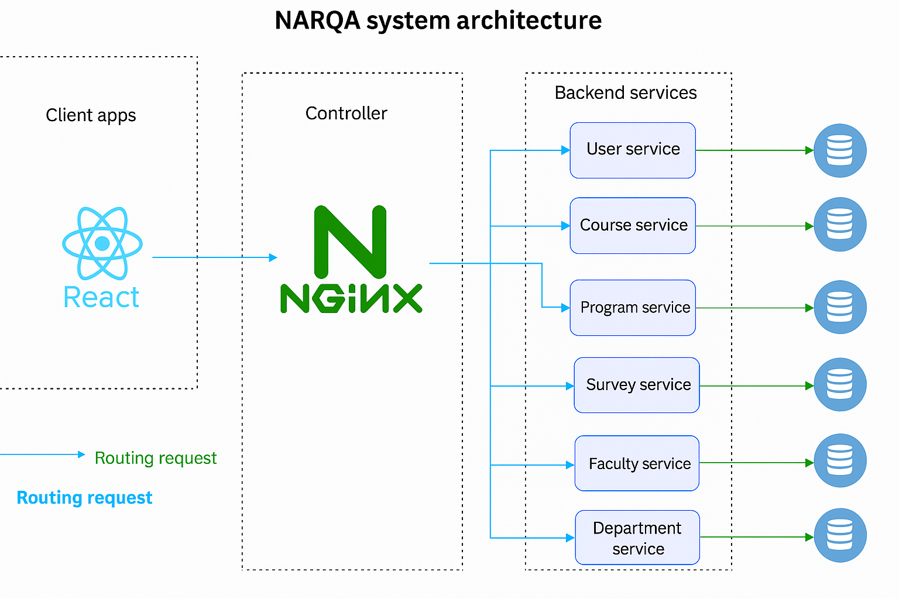
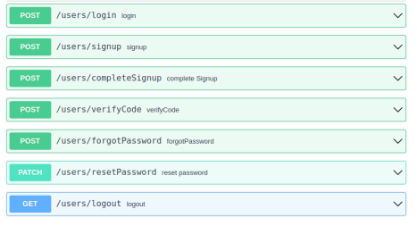
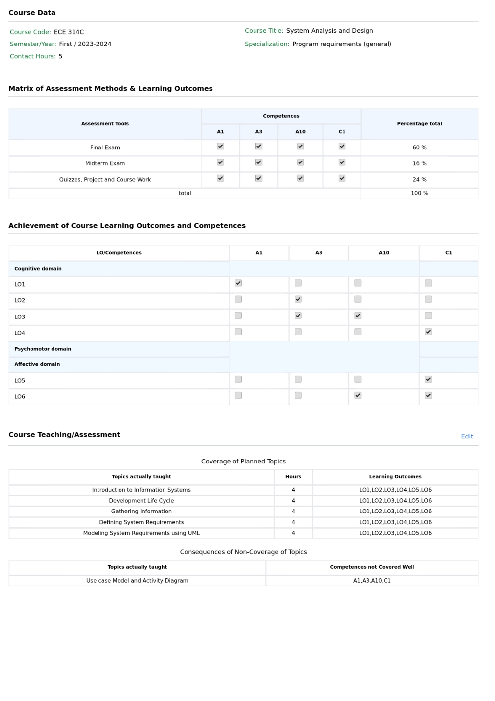
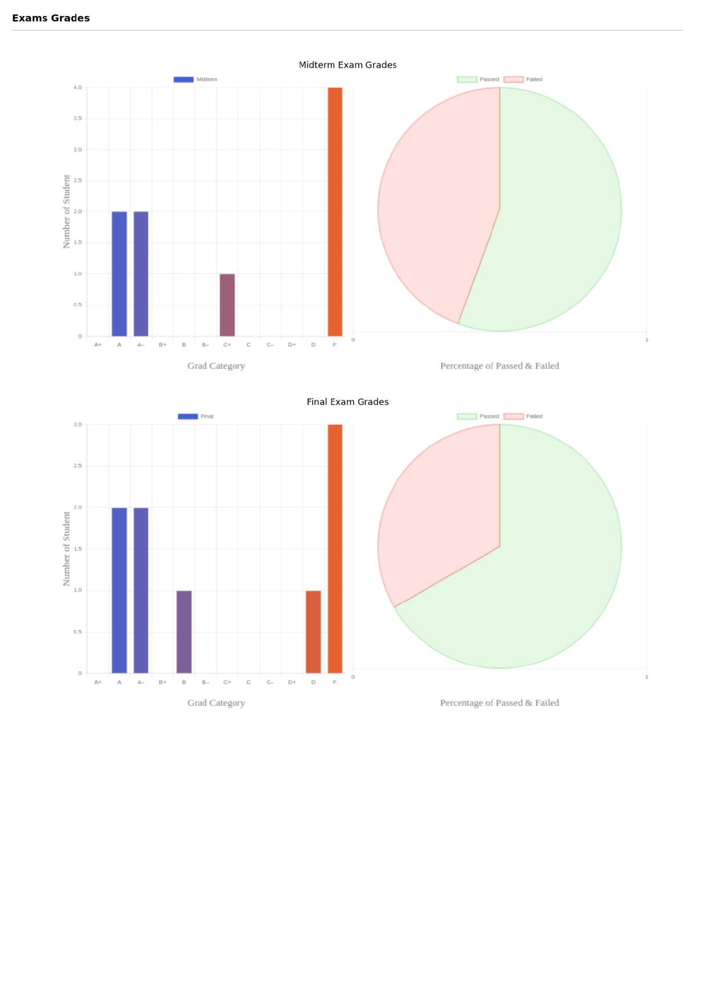
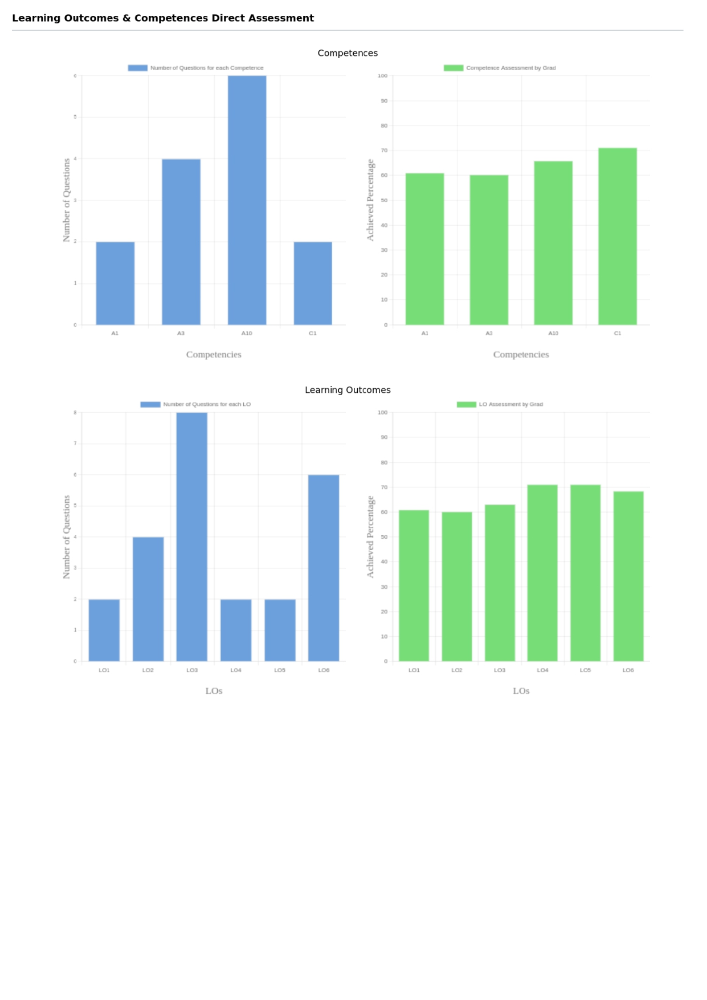
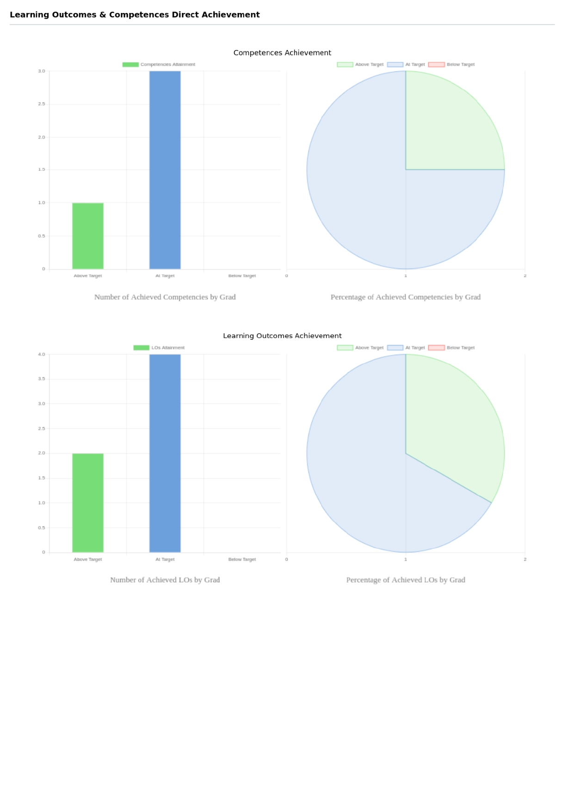
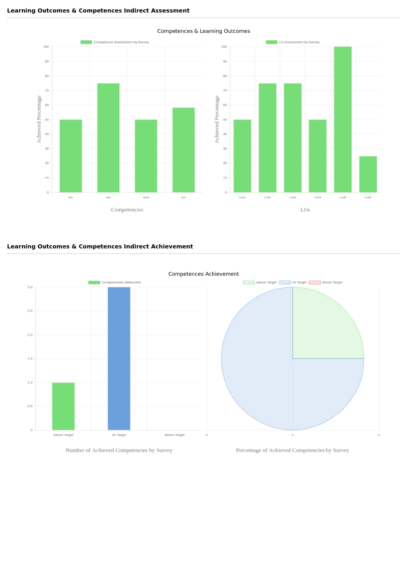
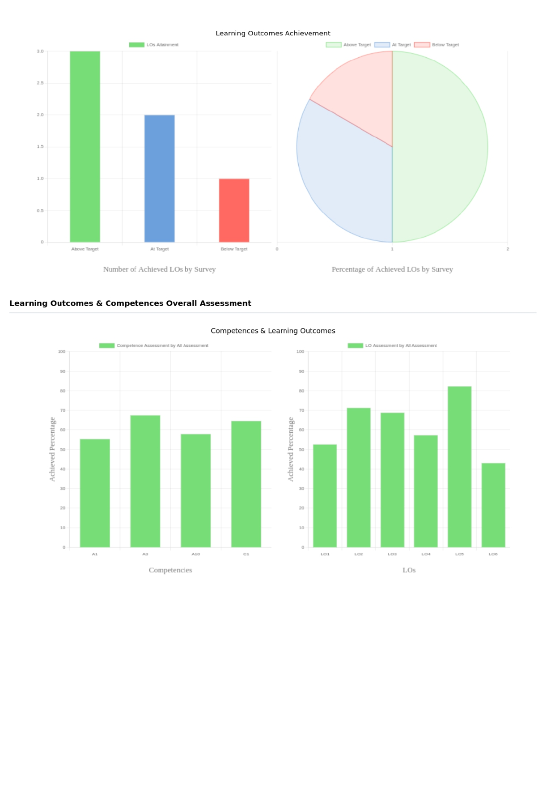
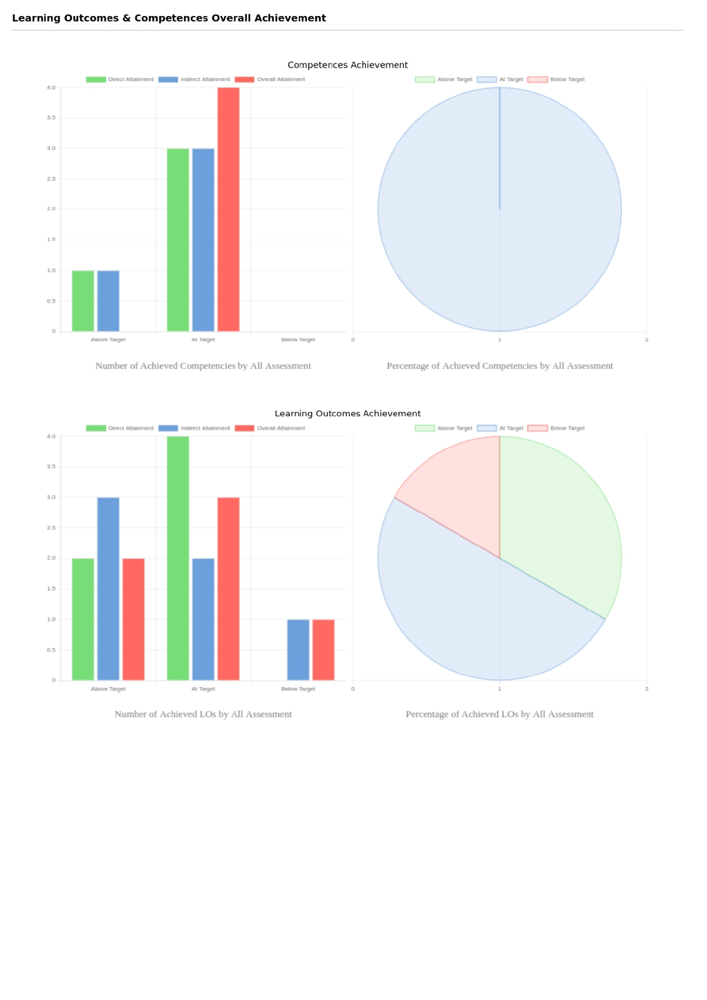

# NARS Quality Assurance

NARS Quality Assurance is a modular platform designed to manage and streamline **academic quality assurance** processes.  
It provides structured modules for competencies, courses, programs, surveys, users, and more — all containerized for easy deployment.


---

## 🚀 Features

- 📊 Quality assurance modules for academic programs  
- 🧱 Modular structure (competences, courses, surveys, users, etc.)  
- 🐳 Docker & Nginx configuration for deployment  
- 🔐 User management and department/faculty organization  
- 🧾 Survey collection and evaluation  
- 🌐 Public asset handling

---

## System High Level Design (HLD)

---

## 📂 Repository Structure

```
.
├── competences
├── courses
├── department
├── faculty
├── nginx
├── programs
├── public
├── shared
├── surveys
├── users
├── docker-compose.yml
├── .gitignore
└── README.md
```

| Folder            | Description                                                          |
|--------------------|-----------------------------------------------------------------------|
| `competences`     | Competence definitions, logic, assessment                              |
| `courses`         | Course management (curricula, metadata, relations)                      |
| `department`      | Department-level operations and data                                   |
| `faculty`         | Faculty and staff modules                                             |
| `nginx`           | Reverse proxy and routing configuration                               |
| `programs`        | Academic programs and structure                                      |
| `public`          | Publicly accessible static assets                                    |
| `shared`          | Common utilities, helpers, services                                 |
| `surveys`         | Survey forms, templates, and collection                              |
| `users`           | Authentication, authorization, user data                             |

---

## 🛠️ Tech Stack

- **Backend:** Node.js
- **Containerization:** Docker, Docker Compose  
- **Web Server / Proxy:** Nginx  
- **Database:** MongoDB

---

## ⚙️ Getting Started

### 1. Prerequisites

- [Docker](https://www.docker.com/)  
- [Docker Compose](https://docs.docker.com/compose/)  

### 2. Installation
1. Clone the repository
```bass
git clone https://github.com/Ahmed-Hassanen/nars-quality-assurance.git
cd nars-quality-assurance
```
2. Create or copy .env file for environment-specific configurations (ports, database credentials, etc.)

### 3. Configuration

- Ensure environment variables in .env are set correctly.
- Modify docker-compose.yml if you need to change ports, volumes, or add services.
- Verify the Nginx configuration under the nginx folder matches your domain / routing logic.

### 4. Run the Project

```bash
docker-compose up --build
```

Visit: localhost:&lt;port&gt;/

To stop:

```bash
docker-compose down
```

---


## 🧪 Usage

You can interact with the system via:

- **Web Interface:** Localhost or deployed domain  
- **API:** REST endpoints (see in full [Documentation](https://drive.google.com/file/d/17pQilTzCXtROlvrsKaBzMITSepdkg5Dg/view?usp=sharing))  


---

## Generated Course Report









---

## Full Documentation
[Documentation](https://drive.google.com/file/d/17pQilTzCXtROlvrsKaBzMITSepdkg5Dg/view?usp=sharing)


